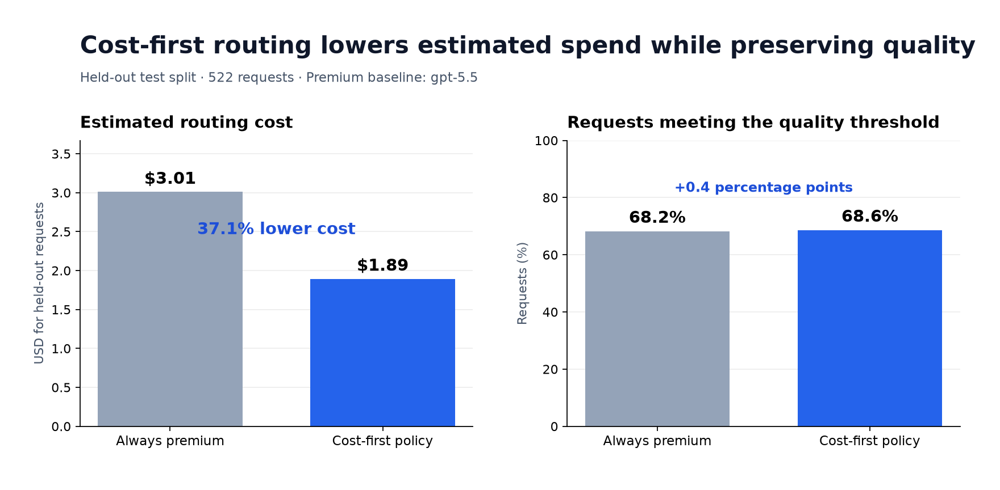
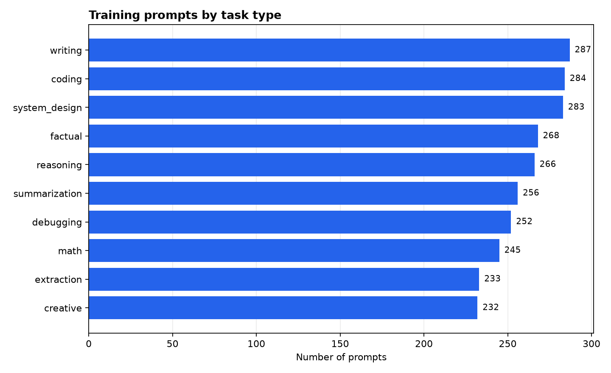
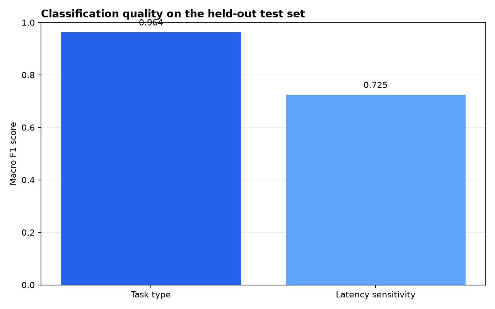

# Adaptive LLM Router

Adaptive LLM Router is a small prototype for choosing an appropriate language model for a prompt. It learns useful request attributes from the prompt, then uses a capability table to identify the lowest-cost model that meets the requested quality level.

## The objective: lower cost without compromising the requested quality

On the held-out test split, the cost-first policy reduces estimated spend by **37.1%** compared with always selecting `gpt-5.5`, while slightly increasing the rate of requests that meet their quality threshold.



## What it does

1. Embeds each prompt with `sentence-transformers/all-MiniLM-L6-v2`.
2. Predicts the task type, difficulty, required quality, expected output size, and latency sensitivity.
3. Filters the model capability table by task type and minimum quality.
4. Estimates input and output cost for the eligible models.
5. Selects the least expensive eligible model.

The capability table is a seed dataset for experimentation. Its model quality and cost values are assumptions rather than live provider data.

## Architecture

### Offline training

```text
                          Labelled Prompt Dataset
                                  |
                                  v
                              Data Loader
                                  |
                                  v
                            MiniLM Embedding Model
                            all-MiniLM-L6-v2
                                  |
                                  v
                          Stored Embeddings + Metadata
                                  |
                                  v
                              Model Training
                                  |
      +-----+---------+-----------+----------------+--------------------+
      |               |           |                |                    |
      v               v           v                v                    v
    Task Type      Difficulty  Required Quality  Output Tokens  Latency Sensitivity
    Logistic       Gradient    Gradient          Random Forest  StandardScaler
    Regression     Boosting    Boosting          Regressor      + LinearSVC
      |               |           |                |                    |
      +---------------+-----------+----------------+--------------------+
                                  |
                                  v
                        Saved Model Artifacts
```

### Inference

```text
                  User Prompt
                       |
                       v
                  FastAPI API
                       |
                       v
                 Prompt Classifier
                       |
              +--------+--------+
              |                 |
              v                 v
        Embedding Model    Trained ML Models
              |                 |
              +--------+--------+
                       |
                       v
              Prompt Predictions
              - task_type
              - difficulty_bucket
              - required_quality
              - estimated_input_tokens
              - expected_output_tokens
              - latency_sensitivity
                       |
                       v
                  LLM Router
                       |
              +--------+--------+
              |                 |
              v                 v
       Capability Table    Routing Policy
              |                 |
              +--------+--------+
                       |
                       v
                 Selected LLM
```

The API currently validates routing fields through `POST /route`. Connecting it to the predictor and the policy is the next implementation step.

## Dataset

The merged dataset contains **2,606 prompts** across ten task types. It is deliberately balanced enough to support a first routing baseline.



Each record includes a prompt and labels used for routing: `task_type`, `difficulty`, `required_quality`, `expected_output_tokens`, and `latency_sensitivity`. The split is 80% training and 20% testing, with a fixed random seed (`42`).

## Evaluation

The models are evaluated on the held-out test split. Classification results use macro F1 so every class has equal weight.



| Target | Model | Result |
| --- | --- | --- |
| Task type | Logistic Regression | 0.966 accuracy, 0.964 macro F1 |
| Latency sensitivity | StandardScaler + LinearSVC | 0.759 accuracy, 0.725 macro F1 |
| Difficulty | Gradient Boosting Regressor | 0.113 MAE, 0.632 R² |
| Required quality | Gradient Boosting Regressor | 0.037 MAE, 0.773 R² |
| Expected output tokens | Random Forest Regressor | 125.0 MAE, 0.706 R² |

Task type and required quality are the strongest signals in this baseline.

## Model-selection policy

`cost_first_policy` receives the predicted task type, difficulty bucket, required quality, and expected token counts. It keeps models whose quality for that task and difficulty is high enough, estimates their request cost, and returns the cheapest one.

```python
from adaptive_llm_router.router.policy import cost_first_policy

request = {
    "task_type": "reasoning",
    "difficulty_bucket": "medium",
    "required_quality": 0.80,
    "estimated_input_tokens": 500,
    "expected_output_tokens": 200,
}

selected_model = cost_first_policy(request, capability_table)
```

### Compare the policy with an always-premium baseline

The offline comparison evaluates the held-out requests twice: once with `gpt-5.5` selected for every request, and once with the cost-first policy. It reports estimated cost, capability quality, quality-threshold compliance, savings, and the models selected by the policy.

```bash
uv run python -m adaptive_llm_router.evaluation.compare_policy
```

Results are saved to `evaluation/policy_comparison.json`. This is a routing simulation based on the seed capability table, not a live provider benchmark or an evaluation of generated answers.

## API

The FastAPI app currently provides a small validated API surface for the routing request. `POST /route` validates the request and returns its routing fields; wiring this endpoint to the prediction models and `cost_first_policy` is the next implementation step.

Start it locally:

```bash
uv run fastapi dev src/adaptive_llm_router/api/main.py
```

Then send a request:

```bash
curl -X POST http://127.0.0.1:8000/route \
  -H "Content-Type: application/json" \
  -d '{
    "task_type": "reasoning",
    "difficulty_bucket": "medium",
    "required_quality": 0.8,
    "estimated_input_tokens": 500,
    "expected_output_tokens": 200
  }'
```

```json
{
  "status": "success",
  "task_type": "reasoning",
  "difficulty_bucket": "medium",
  "required_quality": 0.8
}
```

`GET /health` returns `{ "status": "ok" }`.

## Run the project

This project uses Python 3.12+ and [uv](https://docs.astral.sh/uv/).

```bash
uv sync
uv run python -m adaptive_llm_router.data.embedding
uv run python -m adaptive_llm_router.model.train
uv run python -m adaptive_llm_router.model.evaluate
```

The embedding command downloads the MiniLM model on its first run. Training stores model files in `artifacts/`, and evaluation refreshes `evaluation/evaluation_results.json`.

To regenerate the README charts after updating the data or evaluation results:

```bash
uv run python -m adaptive_llm_router.evaluation.generate_readme_charts
```

## Tests

```bash
python -m unittest discover -s tests -p "test_*.py" -v
```

The API test covers the health endpoint, a valid routing request, and request validation.

## Project layout

```text
src/adaptive_llm_router/
├── api/        FastAPI application and request schemas
├── data/       Dataset loading and embedding generation
├── model/      Training, prediction, and evaluation
└── router/     Cost-first model-selection policy
data/           Raw data, processed metadata, and embeddings
evaluation/     Saved metrics
scripts/        Utility scripts
tests/          API tests
```
